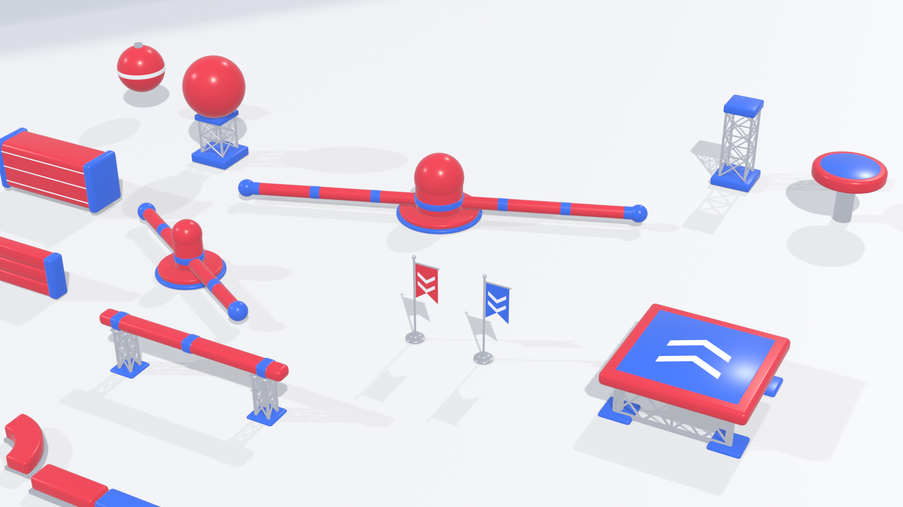

# Splashdown — Blender Asset Pass (overnight report)

Date: 2026-11-11 · Blender 5.2.2 LTS (background mode) · Unity 6000.6.6f1 URP (**not opened**)

*Assembled board rendered in Blender (EEVEE). Reference: `Stylized Obstacle Course Asset Collection-2.png`.*

## Read this first

- This pass produced **staged Blender source + FBX exports only**. Nothing was imported into Unity, no production
  asset, scene, prefab, script or material was changed, and no gameplay system was touched.
- **Unity import test (added 2026-11-12):** `SD_Sweeper_Small.fbx` and `SD_JumpPad_Small.fbx` were imported in a throwaway project
  (Unity 6000.6.6f1, batch mode, built-in pipeline, outside this repo). The other 15 FBX files have **not** been imported. Not tested: URP materials, colliders, the real course scenes, in-game behaviour.
  (My first note said a Unity editor was running; that was wrong. It was a Unity Hub helper process.)
- Art direction was taken from the approved reference image and Phase 3 documentation; I made no change of direction.
  Final visual approval is yours.

## Completed

All files live under `ArtStaging/Blender/` (outside `Assets/`, so Unity will not import them until you move them).

| Asset (`SD_*`) | Replaces / supports | Tris | Key dimensions (m) | Pivot (origin) |
| --- | --- | ---: | --- | --- |
| `BallMount` (2 objects: `BallMount`, `Ball`) | Ball on support | 4,244 | Ball Ø 2.2, mount 1.5×1.5×1.88 | Mount: base centre. Ball: sphere centre |
| `Sweeper_Small` (`Base`, `Arm`) | `SweeperSmall` (reach 3.6) | 9,372 | Arm span 7.8, tube Ø 0.42, hub r 0.45 H 1.35 | Base: axis on floor. Arm: rotation axis at z = 0.5 |
| `Sweeper_Large` (`Base`, `Arm`) | `SweeperLarge` (reach 6.6) | 10,124 | Arm span 13.8, hub r 0.79 | same |
| `JumpPad_Small` / `_Large` | Round pads | 2,864 each | Top Ø 2.4 / 4.0, 0.45 cushion, pillar below | Centre of walkable top (z = 0) |
| `BalanceBeam` | Narrow beam | 3,904 | 6.0 × 0.5 × 0.36 top | Centre of walkable top |
| `Platform_4x4`, `Platform_8x4` | Landing / competition platforms | 2,968 / 3,712 | 4×4 / 8×4 top, 0.4 cushion, truss + feet below | Centre of walkable top |
| `PistonWall` | `PistonWall` prefab | 1,576 | 4.0 × 1.3 × 1.7 (+ caps) | Ground under block centre; push axis = X |
| `PendulumBob` | Pendulum weight | 2,776 | r 0.9 | Sphere centre |
| `PaddedBarrier` | Padded barriers | 1,756 | 3.0 × 0.55 × 1.4 | Base centre; tiles along X at 3.0 |
| `Flag_Red`, `Flag_Blue` | Red/blue markers | 1,400 each | 2.78 tall | Base centre |
| `WaterEdge_Red`, `_Blue`, `_Corner` | Water-edge trim | 536 / 536 / 1,112 | 2.0 × 0.84 × 0.54; corner inner r 0.9 | Base centre / arc centre |
| `Support_Truss` | Structural support | 1,960 | 1.4 × 1.4 × 3.0 | Base centre |

17 assets, 53,104 triangles total, largest 10,124.

Locations (per asset `<name>`):

- Blender source: `ArtStaging/Blender/src/<name>.blend`
- Metadata (pivot, axis, collider assumptions): `ArtStaging/Blender/src/<name>.json`
- FBX (Y-up, −Z forward, metres, scale applied): `ArtStaging/Blender/export/<name>.fbx`
- Previews: `ArtStaging/Blender/previews/<name>.png`, plus `_assembled.png`
- Scripts: `ArtStaging/Blender/scripts/` (`sd_lib.py`, `build_assets.py`, `validate_assets.py`, `render_previews.py`);
  `ArtStaging/Blender/build_all.sh` rebuilds, validates and re-renders everything.

### Gameplay-critical dimensions kept from the existing prefabs

Taken from `Foundation1Builder.Course1Prefabs.cs`; I did not edit that file.

- Sweeper: hub radius formula `clamp(reach×0.12, 0.45, 0.85)`, hub height 1.35, arm axis at y = 0.5, tube thickness 0.42, two opposed
  bars, rotation about local Y. The mesh pads are r 0.30; the prefab collider uses 0.34 (keep the prefab colliders).
- Ball: radius 1.1 (matches the `BouncingBall` sphere collider).
- Piston wall: 4.0 × 1.3 × 1.7 body at y = 0.1–1.8.
- Pendulum weight: r 0.9.

Colliders are **not** exported. The metadata JSON lists the collider shape to keep or add per asset.

## Validation

`ArtStaging/Blender/scripts/validate_assets.py` reopens every `.blend`; results are in `ArtStaging/Blender/validation.json`.

| Check | Result |
| --- | --- |
| Source `.blend` files reopen | 17 / 17 pass |
| Meshes contain geometry | 17 / 17 |
| Non-manifold edges | 0 on all (two sweepers had 96 each; fixed by overlapping capsule ends 1 cm) |
| Duplicate vertices | 0 on all |
| Normals outward (signed volume) | 17 / 17 |
| UV layer present | 17 / 17 (Smart UV Project) |
| Materials assigned, no empty slots | 17 / 17 (palette only: `SD_Red/Blue/White/Chrome/Water/Pad`) |
| Scale applied and positive, no rotation | 17 / 17 |
| Triangle budget (25,000 per asset) | 17 / 17 (the budget is my own, not from the project) |
| FBX exists, nonempty | 17 / 17 (1.5 MB total) |
| FBX reimports into Blender | 17 / 17 |
| Pivots and dimensions documented | 17 / 17 |
| Existing production files intact | Yes; `git status` shows only `ArtStaging/` and `Docs/` additions (`.vsconfig` was already untracked) |

Previews: every asset rendered from a 3/4 view; one assembled board. Assembly is a plain layout, not a scene from the game.

## Unity import test results (2 assets)

| Check | Sweeper_Small | JumpPad_Small |
| --- | --- | --- |
| Imports without errors | Yes | Yes |
| Root scale / rotation | 1 / 0 | 1 / 0 |
| Orientation (Y-up) | Height on Y: base 1.82, arm at y = 0.5 | Top at y = +0.01, mesh down to −2.33 |
| Arm pivot at rotation axis | Yes: `Arm` local position (0, 0.5, 0), local rotation 0 | n/a |
| Bounds | Arm 7.8×0.6×0.6, Base 2.2×1.82×2.2 | 2.4×2.34×2.4 |
| Triangles equal Blender | 3,728 + 5,644 = 9,372 | 2,864 |
| Normals and UVs present | Yes | Yes |
| Materials created | SD_Red, SD_Blue, SD_Chrome | SD_Red, SD_Blue, SD_Chrome |

The Arm and Base come in as separate child objects, so a `RotatingSweeper` can drive Arm about Y. Licensing printed an access-token warning in the log; it did not affect the import.

## URP materials (added 2026-11-12)

- `ArtStaging/Unity/Materials/SD_Red|Blue|White|Chrome.mat` (URP Lit), generator `ArtStaging/Unity/Editor/SDMaterials.cs`, notes in `ArtStaging/Unity/README.md`.
- Tested in the scratch project with URP 17.6.0 (the version the game uses): all four use `Universal Render Pipeline/Lit` and the shader reports supported. Remapping the two imported FBX files assigned the SD_* materials to every slot (4 remaps each, no embedded materials left).
- **Not verified:** how they look. Batch mode cannot render, and the scratch project was Gamma colour space while Splashdown is Linear. The colour conversion is written to match in both, but compare against the previews in the real project. Chrome needs a skybox or reflection probe.
- The `.mat` files were not added to the real project.

## Real-project import check (2026-11-12, branch astra/blender-unity-import)

Imported `SD_Sweeper_Small`, `SD_Sweeper_Large`, `SD_JumpPad_Small`, `SD_BallMount` plus the four materials into `Assets/BikiniWipeout/Art/SD/` (new folder; no existing asset, scene, prefab or setting changed — `git diff` on tracked files is empty). Checked in batch mode by `Art/SD/Editor/SDImportCheck.cs` (read-only; the Course 1 scene was opened but never saved). Output: `ArtStaging/SD_import_check.txt`.

- Project is Linear colour space with URP (`PC_RPAsset`). All four materials use URP Lit; every FBX slot is remapped to the project's `Art/SD/Materials`.
- Arm pivot: local (0, 0.5, 0) in both FBX and existing prefabs; placed at `A_Sweeper_1`'s transform the new Arm lands at the identical world position (0, 0.5, 43).
- Length and height match the prefabs: Small 7.80 vs 7.87 m long, 1.82 m tall; Large 13.80 vs 13.87, 2.18 m tall.
- **Footprint is wider than the prefab:** the new base disc is Ø 2.2 m (Large Ø 2.9); the prefab hub is about 0.9 m (Large 1.7 m). On `A_Sweeper_1`'s island 14 of 16 rim points of the disc have ground under them, so the disc overhangs the island edge a little. The base is only 0.28 m high and should have **no collider** on the skirt; keep the prefab hub collider. Decide whether the overhang is acceptable or the skirt should shrink.
- **Not done:** no prefab or scene was switched to the new meshes, nothing was rendered or played, colliders were not compared in play, and the PlayMode tests were not run.

## Remaining

- Import settings, material mapping, prefab swapping and collider checks are all open.
- **Ramp / sloped landing from the reference** was not made. It would create a new walkable slope, which is a gameplay change.
- **Pendulum gantry**, **spin disc**, **pistons' pusher faces**, **section and finish arches** were not made. `PendulumBob` and `PistonWall` are done.
- **Sloped/curved water-edge variants** and a pool-corner inner radius beyond the one corner piece.
- **Moving-platform deck and large round islands.** Only the round jump pads and the two rectangular platforms exist.
- Preview board crops a few assets at the frame edge; layout is illustrative.
- Needs your visual approval: the whole set, especially red/blue saturation, chrome truss density, bevel size.

Recommended next steps:

1. Pick two assets (suggest `Sweeper_Small` and `JumpPad_Small`) and do a controlled Unity import on a scratch scene with the Unity editor closed.
2. Create URP Lit materials named `SD_Red`, `SD_Blue`, `SD_White`, `SD_Chrome` and remap on import.
3. Decide how balls should behave (see Risks).

## Risks

- **Stationary ball vs existing design.** The brief says the balls stay stationary. `BouncingBall.cs` and Course 1 currently make them bounce and patrol, with giant ones
  in the narrow alley. `SD_BallMount` is stationary on a support as asked; its `Ball` is a separate object so a bouncing prefab can reuse it. I did not
  change any gameplay. Which behaviour you want is your call.
- **Material compatibility.** Materials are Principled BSDF with flat colours (no textures). FBX carries only an approximation. Do not rely on the imported materials; remap to URP Lit.
  Chrome is a metallic value, so it needs a reflection probe or skybox to look like the previews.
- **Smoothing.** Normals use angle-based smoothing (40°). Unity's FBX importer should keep them, but this is unverified.
- **Collider and pivot compatibility.** Pivots follow each prefab's current layout (documented above), but nothing has been overlaid on the real scene.
  Platform and pad pivots sit at the *top* face, while the existing primitives usually sit at the centre; placement will need an offset.
- **Performance.** Sweepers are the heaviest at about 10k triangles each, mostly finely tessellated capsule bars and spheres. Roughly 25 obstacles × 5–10k would be
  an estimated 150–250k triangles for a course. Unmeasured; lower `segments` in `sd_lib.py` if needed.
- **UVs.** Smart UV Project islands are not packed for baking; fine for flat colours, not for textured use.
- **Art-direction deviations:** none intentional. The red reads slightly lighter/pinker than the reference under the preview lighting.

## Git state

- Repository: `C:\Users\aresg\OneDrive\Documents\Splashdown-Astra`
- Branch: `astra/blender-assets`, created from `astra/phase-3b-integration` @ `02f4466`
- Commit: the one that adds this file (`git log -1 -- Docs/BLENDER_OVERNIGHT_REPORT.md`). Working tree after commit: only the pre-existing untracked `.vsconfig`.
- Not pushed, not merged.
