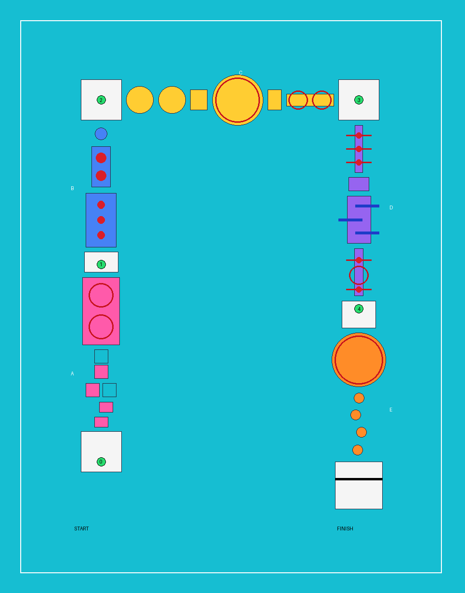

# Splashdown Phase 3 — Arena and Course 1 ("The Splashdown Gauntlet")

Branch: `claude/bikini-wipeout-foundation-1-tcqjy6` · Date: 2026-11-11 · Unity 6000.6.6f1, URP



*Generated from `Course1Layout.cs` by `Tools/render_course1_map.py`. Green dots are checkpoints 0–4,
red rings are sweeper/beam reach, red dots are balls and pendulum weights, blue bars are pistons.*

## Read this first

1. **Nothing here has been run in Unity.** The authoring environment has no Unity licence. Every script
   compiles against the real 6000.6.6f1 assemblies (0 errors, 0 warnings) and the engine-free tests pass
   (122 / 122), including checks that every jump in the course is inside the character's jump envelope.
   The scene generator, the visuals, the physics and the audio have never executed. This is **not** a
   playtested course; it is ready *for* a playtest.
2. **The latest character work was not available.** The repository contained only Foundation 1 (+ zoom
   and controller support) and Astra's `phase-2a-ragdoll-camera` branch. The character integration,
   animation corrections and jump-teleport fix described in the brief were never pushed, so they could
   not be inspected. Phase 3 was therefore built to be **additive**:
   - Astra's Phase 2A branch was merged in (one conflict, in the camera's distance line, resolved so
     zoom feeds Astra's wipeout framing).
   - No movement, ragdoll, knockdown, animation or camera script was edited for Phase 3.
   - Course 1 uses **whatever player prefab the existing course scene uses**, so an integrated
     character carries over. If none is found it falls back to the placeholder mannequin.
   - Merging this branch into the local project should only conflict where that project changed the
     same lines as the Phase 2A merge or the files listed under "Existing files touched".

## The course

A U-shaped course in a stadium: out along the west side, across the far end, back down the east side
to a finish beside the start. About 340 m of travel, five checkpoints, 29 walkable surfaces.

| Section | What it is | Hazards | Ends at |
| --- | --- | --- | --- |
| **A — The Launch Pad** | Start platform and countdown, two small pads, two moving platforms (one sideways, one forward), then a long island | Two short, slow sweepers with 1.9 m safe lanes either side. Every gap is clearable at walking speed | Checkpoint 1 |
| **B — The Big Bounce** | A wide alley, a narrow alley, a round pad, then the first corner | Three bouncing balls on the wide alley; two giant, faster balls that span the narrow one (run under them at the top of the bounce). Gaps grow 1.5 → 1.8 → 2.0 → 2.2 m | Checkpoint 2 (corner) |
| **C — Spin City** | Two counter-rotating spin discs you ride, a rest pad, a large round island, a rest pad, a narrow bridge | Large two-bar sweeper covering the island; two counter-rotating low beams on the bridge with no safe lane (jump them) | Checkpoint 3 (corner) |
| **D — The Chaos Crossing** | 2.4 m-wide bridge, rest pad, piston deck, 2.6 m-wide bridge | Three staggered pendulums; three piston walls pushing across the deck from alternating sides on a timed cycle; then pendulum + beam + pendulum combined | Checkpoint 4 |
| **E — The Final Splash** | Large round island, four rising round pads, raised finish platform | Double sweeper: low bars to jump **and** high bars that hit you if you jump at the wrong moment. Then running jumps of 2.1–2.5 m, each 0.4 m higher than the last | Finish arch, confetti, results |

Falling in the water anywhere returns the player to the last checkpoint, facing the next section.
Corner checkpoints cover their whole platform so they cannot be skirted.

### Designed around the character, not the other way round

Movement values were **not** changed. With the default config (walk 3.2 m/s, run 6.5 m/s, jump height
1.4 m, gravity −24, fall multiplier 1.35) a running jump covers 4.13 m and a walking jump 2.03 m.
`Course1LayoutTests` enforces, for every consecutive pair of surfaces:

- the gap is at most **75 %** of the running jump for that height difference;
- Section A gaps are at most **90 % of a walking jump**;
- no step up exceeds 60 % of the jump height;
- the longest jumps are in the final section.

An editor test repeats the reach check with the project's **actual** `PlayerMovementConfig` asset, so
retuning the character later cannot silently make the course impossible.

## What was reused and what is new

**Reused unchanged:** `CharacterMotor`, `KnockdownController`, `RagdollController`, animation state,
`ThirdPersonCamera`, `PlayerRespawner`, `CourseManager` / `CourseSession` (countdown, timer, pause,
results, restart), `CheckpointManager` / `Checkpoint`, `WaterHazard`, `ImpactSource`, `AudioManager`,
HUD / pause / results UI, and the obstacle components `RotatingSweeper`, `BouncingBall`,
`MovingPlatform`.

**New obstacle prefabs built on those components** (`Prefabs/Course1/`):

| Prefab | Built from |
| --- | --- |
| `SweeperSmall`, `SweeperLarge`, `RotatingBeam` | `RotatingSweeper` + `ImpactSource`, rounded inflatable bars |
| `SweeperDouble` | Same, with extra high bars at 2.35 m |
| `SpinPlatform` | `RotatingSweeper` driving a kinematic deck with no impact source — the motor's existing ground-following carries the player |
| `PistonWall` | `MovingPlatform` + `ImpactSource` on a wall-shaped kinematic body |
| `BouncingBallArena` | Foundation ball + bounce sound |
| `Pendulum` | **New component** (below) |

**New scripts (all additive):**

| Script | Purpose |
| --- | --- |
| `Core/Course1Layout.cs` | The walkable surfaces of Course 1 as data: single source of truth for the builder and the tests |
| `Core/JumpEnvelope.cs` | Jump reach from the motor's parameters |
| `Obstacles/Pendulum.cs` | Swinging kinematic arm, angle is a pure function of time, `IResettable` |
| `Arena/ProximityWhoosh.cs` | Mechanism sound when an arm/weight sweeps past the listener |
| `Arena/CollisionSound.cs` | Bounce sound for physical bodies |
| `Arena/ArenaAmbience.cs` | Looping crowd bed, clip from the central `AudioLibrary`, follows the SFX slider |
| `Arena/FinishCelebration.cs` | Confetti + crowd cheer on completion |
| `Arena/ImpactEffects.cs` | Burst effect where an obstacle knocks the player down (scene-level; no character prefab change) |
| `Arena/SectionAnnouncer.cs` | Shows the section name on the HUD when the player passes its gate |
| `Arena/ScrollingSurface.cs`, `Arena/Bobbing.cs` | Animated water texture; bobbing buoys and flags |
| `Editor/Foundation1Builder.Course1*.cs`, `Editor/Course1AutoSetup.cs` | Generator for the arena, prefabs and scene |

**Existing files touched** (small, additive edits): `AudioEventId.cs` (five new ids), `SceneNames.cs`
(one constant), `ProjectValidator.cs` (Course 1 checks), `generate_placeholder_audio.py` (five new
sounds appended; original sounds are byte-identical). The generated **MainMenu scene** has one field
changed so PLAY starts Course 1 (only if it still pointed at the Foundation course).

## Arena presentation

- **Water:** bright turquoise caustics texture, drifting via a property block (no simulation, opaque,
  no shadows). Foam rings where every support meets the water. Splashes are a droplet burst plus an
  expanding foam ring.
- **Palette:** pink / purple, blue / teal, yellow / orange quilted "inflatable" panels, one scheme per
  section, with contrasting trim, target rings on pads, chevrons on bridges and checkpoint platforms.
- **Stadium:** four stepped stands with an abstract crowd, back walls, striped rails, flags, corner
  floodlight towers, a central jumbotron with the SPLASHDOWN logo, buoys, distant hills and clouds.
- **Signage:** an inflatable arch with a name banner at the start of each section; a larger finish
  arch with a FINISH banner and checker strip.
- **Lighting:** one soft-shadowed sun, flat three-colour ambient, procedural sky, light distance haze.
  Post-processing is enabled on the camera and uses the project's existing profile (bloom 0.25,
  vignette 0.2) — nothing was made stronger.
- All textures are generated by `Tools/generate_arena_textures.py` (original, no third-party licence).

## Audio

New centrally configured events in `AudioLibrary` (appended only if missing, so tuned entries are
kept): `BallBounce`, `MechanismWhoosh`, `CrowdCheer`, `ArenaAmbience`, `ConfettiPop`. Existing hooks
(impacts, splashes, checkpoints, countdown, finish) are reused. All clips are synthesized placeholders.

## Tests

| Check | Result |
| --- | --- |
| Merge of Astra Phase 2A + zoom/controller | Clean after one resolved conflict |
| Compilation of all 6 assemblies against Unity 6000.6.6f1 | **PASS**, 0 errors, 0 warnings |
| Engine-free unit tests (NUnit, outside Unity) | **PASS 122 / 122** (112 existing + 10 new course-layout tests) |
| Top-down map rendered from the layout data | Inspected: connected U, five sections, obstacles on their surfaces |
| Opening the project / generating Course 1 in Unity | **NOT RUN** |
| EditMode `Course1ContentTests` (2), PlayMode `Course1PlayTests` (9) | **NOT RUN** (compiled only) |
| Visual, physics, audio or performance playtest | **NOT DONE** |

No tests failed. The PlayMode suite written for this phase covers: scene wiring and obstacle counts,
spawn + countdown, solid ground under every layout surface, obstacles moving, every checkpoint
activating and respawning the player facing the next section without a loop, a pendulum knockdown and
recovery, a spin disc carrying the player, finish → results + confetti + cheer, section announcement.

## Remaining issues and risks

**Unverified behaviour (most likely to need fixes on first run)**
- The Course 1 generator (~1,750 lines of editor code) has never executed. Errors name the failing step.
- Chevron arrow direction depends on Unity's cube UV orientation; if arrows point backwards, set the
  chevron materials' tiling Y to −3.
- World-space signage uses legacy UI text; size and facing were set by calculation, not by eye.
- Post-processing is switched on through the URP camera component by name; if that fails a warning is
  logged and the game simply renders without it.
- Piston walls push a `CharacterController`, which kinematic bodies cannot physically move. Slow
  contact gives repeated shoves, fast contact a knockdown. This needs tuning by feel.
- Riding the spin discs relies on the motor's existing ground-following; edge behaviour is untested.
- Giant balls in the narrow alley may be too hard or too easy; `bounceHeight` and `travelSpeed` are
  per-instance values in the scene.
- The sweeper islands leave only ~0.5 m of safe rim. Intentional for C and E, but check the landings.

**Performance (estimated, not measured)**
- Roughly 550 renderers, one realtime shadowed light, ~25 kinematic obstacles, 5 dynamic balls, no
  baked lighting. Everything uses URP Lit/Unlit with a handful of materials, so the SRP batcher should
  keep draw calls low, but this is unmeasured.
- Shadows are the likeliest cost. Distant scenery, crowd, water and foam do not cast them. If needed,
  lower the URP asset's shadow distance (50 m) or resolution first.
- Foam rings and the crowd are large transparent / textured quads: cheap, but watch overdraw on
  integrated graphics.
- All obstacles animate for the whole run even when far away; there is no distance-based sleeping yet.

**Not in this phase:** character selection, extra characters, more courses, multiplayer.

## Launching Course 1 locally

```powershell
git fetch origin
git switch claude/bikini-wipeout-foundation-1-tcqjy6     # add --track origin/... the first time
git pull --ff-only
```

If your local project has unpushed work (character, animation and jump fixes), commit it on its own
branch first and merge this branch into it rather than switching away. Do not use a hard reset.

1. Open the project in **Unity 6000.6.6f1**. Wait for import and compilation.
2. Course 1 generates itself on first open (Console: `[Splashdown] Course 1 is ready`) and the scene
   opens. If it does not: **Bikini Wipeout → Course 1 → Build Splashdown Gauntlet (Missing Only)**.
3. Check the `Player` object in the Hierarchy is your integrated character. If it is the placeholder
   mannequin, delete it, drop in your character prefab at the same position, and assign it to
   `Course → Course Manager → Player`, the camera's `Target`, and set its respawner's `Checkpoints`
   to the `Course` object.
4. Press **Play**. Scene: `Assets/BikiniWipeout/Scenes/Course_SplashdownGauntlet.unity`.
   The main menu's PLAY button also starts Course 1.
5. Then run **Bikini Wipeout → Validate Project** and the Test Runner (EditMode, then PlayMode).

To regenerate after pulling changes to the generator:
**Bikini Wipeout → Course 1 → Rebuild Splashdown Gauntlet** (overwrites only the Course 1 scene and
`Prefabs/Course1`; never the player, the Foundation scene, config assets or existing materials).
To move things by hand instead, edit the scene directly — it is an ordinary Unity scene.
