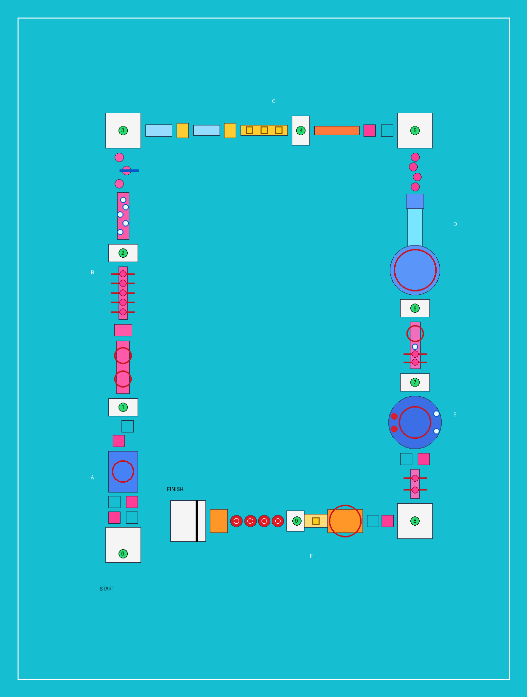

# Splashdown Phase 3 — Course 2: Chaos Cove

Branch: `claude/splashdown-course-2-asv7gw` · Date: 2026-11-11 · Unity 6000.6.6f1, URP, Windows PC



*Generated from `Course2Layout.cs` by `Tools/render_course2_map.py`. Green dots are checkpoints 0–9, red
rings are sweeper / spinning-arm reach, pink dots are swinging balls, white dots are geysers, yellow
squares are tipping buckets, red discs are the Big Balls, hollow squares are where movers travel to.*

## Read this first

1. **Nothing here has been run in Unity, and no interactive playtest was performed.** The authoring
   environment has no Unity licence. Every script compiles against the real 6000.6.6f1 assemblies
   (0 errors, 0 warnings) and the engine-free tests pass (150 / 150), including checks that every jump
   in the course — the Big Balls in particular — is inside the character's jump envelope. The scene
   generator, the physics, the visuals and the audio have never executed. Course 2 is ready *for* a
   playtest; expect a first round of fixes and tuning when it first runs.
2. **Course 2 is strictly additive, and merges cleanly with Astra's and Terra's branches.**
   - It is a new scene, new prefabs (`Prefabs/Course2`), new materials (`Materials/Course2`).
   - It uses **whatever player prefab the project's course scenes use** (after merging Astra's branch,
     that is the cowgirl), and every obstacle talks to the shared `PlayerCharacter` / `CharacterMotor` /
     `KnockdownController` interfaces, never to a model.
   - Course 1, the Foundation scenes, the player prefab and all config assets are not modified.
   - A trial merge of this branch with `astra/phase-3b-integration` and
     `codex/terra-splashdown-ui-foundation` had **no conflicts** and compiles with 0 errors. See
     "Integration with Astra's and Terra's branches". Those branches were only read, never changed.
3. **One existing gameplay file is edited:** `CharacterMotor.cs` gains an additive `Launch(float)`
   method (bounce pads and geysers need a way to throw the character upwards; there was none). It is
   30 lines, changes no existing behaviour, and is the only place a merge with local motor changes
   could conflict. See "Existing files touched".

## The course

A loop of four legs that finishes beside the start. Measured the same way for both courses (through
the centres of consecutive surfaces), Course 1 is 298 m and Course 2 is **460 m — 1.54×**. 48 walkable
surfaces, 31 placed hazards, 10 checkpoints, 6 sections.

| Section | What it is | Obstacles (sheet no.) | Ends at |
| --- | --- | --- | --- |
| **A — Splash Entry** | Two sideways movers, a sweeper island, a diagonal mover. The smallest gaps in the course (1.2–1.6 m) | Moving platforms (02), rotating sweeper (01) | Checkpoint 1 |
| **B — Timing Terrace** | Bridge filled by two counter-rotating four-arm spinners, a rest pad, a narrow bridge under five swinging balls, checkpoint 2, a geyser walk, three stepping pads with a side jet across the middle one | Spinning arms (08), swinging balls (10), water jets (05) | Checkpoint 3 (corner) |
| **C — Wobble Wharf** | Two seesaws, a bridge under three tipping buckets that dump in sequence, checkpoint 4, a seven-plank collapsing bridge, a forward mover | Seesaws (03), tipping buckets (06), collapsing bridge (09), moving platform (02) | Checkpoint 5 (corner) |
| **D — Bounce and Slide** | Four bounce pads climbing 4 m to a canopied tower, a 13 m water slide down, straight into the reach of a giant double sweeper | Bounce pads (04), water slide ramp (07), rotating sweeper (01) | Checkpoint 6 |
| **E — The Floating Arena** | Combo bridge (spinner + geyser + two swinging balls), checkpoint 7, an 18 m floating raft that leans under you with giant arms in the middle, two geysers on one rim lane and two bouncing balls on the other, then a mover and a bridge with two more swinging balls | Floating arena (11) combining 08, 05 and the Course 1 balls; 10; 02 | Checkpoint 8 (corner) |
| **F — The Big Balls** | Forward mover, a deck swept by giant arms, a ramp with a bucket that washes you back down, checkpoint 9 on the ball deck, **four Big Balls**, landing pad, finish | Big Balls (13), spinning arms (08), tipping bucket (06), finish gate (12) | Finish arch, confetti, results |

**Sprint is expected throughout**, as on Course 1 with the current character: the approved 1.5 m/s walk
gives a walking jump of about 0.95 m, so even Section A's gaps need Sprint held. Every gap is sized
against the *running* jump (6.5 m/s, 1.4 m high), which Astra's integration did not change.

Recovery areas (rest pads or checkpoint platforms) separate every intense sequence. No two checkpoints
are more than 70 m apart, and one sits directly in front of the Big Balls, so a missed jump costs seconds.

### The Big Balls

Four red spheres, 4 m across, on fixed posts, crowns 2.6 m above deck level and 4.8 m above the water,
4.7 m centre to centre (0.7 m between them).

- **They cannot move.** The prefab has no Rigidbody and no component that moves anything. A PlayMode
  test records their transforms and checks they are identical after the player has stood on them; an
  EditMode test checks the prefab for Rigidbodies, rotators and tilting components.
- **The controls are not touched.** `SlipperySurface` never alters input, speed or jump. It models a
  slope with almost no friction: wherever the ball is steeper than its traction can hold (about 7°)
  the character accelerates downhill at `g (sin θ − μ cos θ)`, on top of whatever the player steers.
  The crown is safe; everything else slides you off, slowly near the top and quickly near the sides.
- **Off-centre landings bounce.** Landing more than 16° from the top turns part of the landing speed
  into a slide down the ball and a small hop. It can be saved by steering back up-slope; usually it
  is not.
- **The jump is real but makeable.** With the current movement values a full running jump travels
  4.13 m; the balls are 4.7 m apart, so a jump taken a short stride past the crown lands on the next
  crown. A walking hop (2.03 m) lands in the gap. `Course2LayoutTests` and `Course2ContentTests` check
  all of this against the default values and against the project's actual `PlayerMovementConfig`.
- **Falls use the existing systems.** A miss drops the character (or its ragdoll) into the existing
  `WaterHazard`; the existing respawner returns it to the ball deck.

Tuning lives on the `Ball` child of `Prefabs/Course2/BigBall.prefab`: `Traction` (lower = slicker),
`Slide Gravity`, `Landing Bounce`, `Landing Hop`, `Bounce Min Angle`. Spacing is `BigBall_n` in
`Course2Layout.cs`.

## Obstacle reference

Every obstacle is one prefab in `Prefabs/Course2` built on a reusable component. Timed hazards are
pure functions of elapsed time, so their patterns are learnable and reset exactly.

| # | Obstacle | Prefab | Component | Main tuning |
| --- | --- | --- | --- | --- |
| 01 | Rotating sweepers | `CoveSweeper`, `CoveDoubleSweeper` | `RotatingSweeper` + `ImpactSource` (existing) | Rotation Speed, Impact Force |
| 02 | Moving platforms | `CoveMovingPlatform` | `MovingPlatform` (existing; any waypoint path) | Waypoints, Speed, Dwell Time |
| 03 | Seesaws | `SeesawWide`, `SeesawNarrow` | `TiltingPlatform` (new) | Max Tilt (9°), Stiffness, Damping, Max Tilt Speed |
| 04 | Bounce pads | `BouncePad` | `BouncePad` (new) | Launch Speed (10.3 m/s = 2.2 m) |
| 05 | Water jets | `WaterGeyser`, `WaterSideJet` | `WaterJet` (new) | Period, Warning Time, Active Time, Cycle Offset, Launch Speed / Push Acceleration |
| 06 | Tipping buckets | `TippingBucket` | `TippingBucket` (new) | Period, Warning Time, Push Direction, Water Speed |
| 07 | Water slide | built in the scene | `SlipperySurface` (new) | Traction, Slide Gravity, Max Slide Speed |
| 08 | Spinning arms | `SpinningArms`, `GiantArms` | `RotatingSweeper` + `ImpactSource` (existing) | Rotation Speed, Impact Force |
| 09 | Collapsing bridge | `CollapsingBridgeSegment` | `CollapsingPlatform` (new) + `ObstacleResetter` (new) | Warning Delay, Restore Delay |
| 10 | Swinging balls | `SwingingBall` | `Pendulum` + `ImpactSource` (existing) | Period, Amplitude, Start Phase |
| 11 | Floating arena | `FloatingArena` | `TiltingPlatform` (Raft mode) + hazards parented to its deck | Max Tilt (4°), Idle Sway |
| 12 | Checkpoints / finish | `CheckpointGate`; Course 1 `FinishGate` | `Checkpoint`, `FinishLine`, `FinishCelebration` (existing) | — |
| 13 | Big Balls | `BigBall` | `SlipperySurface` (Sphere mode) | see above |

How the new ones behave:

- **Seesaws and the arena** tilt with a clamped, damped spring computed in script, not free rigidbody
  physics. They cannot exceed their limit, they return to level when unloaded, and they cannot explode.
  The motor rides them through its existing platform-following.
- **Bounce pads** launch on contact at a fixed speed. The rise is not shortened when the jump button is
  not held, so the height is the same every time. Steering is untouched.
- **Geysers** bubble for 0.7 s, then fire for 1.1 s: a character over one is thrown upwards and kicked
  outwards. **Side jets** push across the path while they fire. Both push ragdoll bones too, so a
  wipeout can be juggled.
- **Tipping buckets** wobble for a second (with a creak) before dumping. A character underneath gets a
  normal impact through `IImpactReceiver`, so thresholds, ragdoll, immunity and recovery are the
  existing ones.
- **Collapsing planks** shake for 0.55 s when stepped on, then drop. They restore after 4.5 s, and
  immediately on any respawn.
- **The water slide** accelerates the character downhill by moving it through its
  `CharacterController` (so it collides normally and cannot pass through anything), has solid rails,
  and on leaving hands its speed to the motor as ordinary momentum that fades in under a second.

## Layout as data

`Scripts/Core/Course2Layout.cs` is the single source of truth: surfaces, hazards, checkpoints and
gates. The generator builds the scene from it, the map tool draws it, and the tests check it. To move
or retime something, edit the layout (or the generated scene directly — it is an ordinary scene).
`CourseLayoutMath` and the extra `CourseSurface` fields (`Drop`, `Sag`, `LaunchSpeed`, `BodyRadius`)
are course-independent, so later, longer courses can reuse them without touching the player.

## Environment and performance

- **Look:** turquoise water (reused), blue decks with pink and yellow trim on blue pillars, rock cliffs
  with five waterfalls on three sides, a beach with striped pavilions behind the start, a rock island
  with a waterfall and the big screen inside the loop, islets, 30-odd palms, a canopied slide tower.
  All from primitives and six small procedural textures (`Tools/generate_cove_textures.py`).
- **Cost controls:** scenery has no colliders; distant scenery casts no shadows; plain scenery is
  flagged for static batching; palms and flowers have LOD groups that cull them when small; every
  water effect has a hard particle cap (90 per jet, 26 per waterfall) and jets only emit while
  warning or firing; all obstacles are kinematic and script-driven except the two arena balls.
- **Not measured.** Rough count: about 900 renderers before batching, one shadowed light, 40-odd
  kinematic bodies, 2 dynamic. If the frame rate needs help, lower URP shadow distance first, then
  remove islets.

## Audio

Nine new events in the central `AudioLibrary` (appended only if missing, so the committed library and
any tuned entries are kept): `SpringBounce`, `WaterJet`, `BucketWarning`, `BucketDump`, `SlideWhoosh`,
`BridgeCrack`, `BridgeCollapse`, `InflatableBoing` and the looping `TropicalAmbience`. Their ids are
40–48, in their own range, because Terra's UI branch uses 18–22 and the ids are serialized. Rotating machinery, impacts, splashes, checkpoints and the finish reuse
the existing hooks. Each entry has a minimum interval so repeated triggers cannot stack up, and
everything follows the existing SFX volume slider.

**All nine clips are synthesized placeholders** (`Tools/generate_placeholder_audio.py`, files
`sfx_spring_bounce`, `sfx_water_jet`, `sfx_bucket_creak`, `sfx_bucket_dump`, `sfx_slide_whoosh`,
`sfx_bridge_crack`, `sfx_bridge_collapse`, `sfx_inflatable_boing`, `amb_tropical_waterpark_loop`).
Replace them by assigning new clips in `Settings/AudioLibrary.asset`; no code changes are needed.

## Existing files touched

| File | Change |
| --- | --- |
| `Runtime/Character/CharacterMotor.cs` | New `Launch(float upwardSpeed)` method and a private flag so a launch is not cut short by the short-hop rule. No existing behaviour changes |
| `Core/Course1Layout.cs` | Seven `SurfaceKind` values appended; four fields added to `CourseSurface`, all defaulting to 0 |
| `Runtime/Audio/AudioEventId.cs` | Nine ids added (40–48), in their own block so they merge cleanly with other branches' additions |
| `Runtime/Course/SceneNames.cs` | One constant |
| `Editor/ProjectValidator.cs` | Course 2 checks |
| `Tools/generate_placeholder_audio.py` | Nine sounds appended; all earlier clips are byte-identical |
| Generated **MainMenu scene** | Course 2 is registered with the menu (see below). Nothing else in the scene changes |

Camera, ragdoll, knockdown, animation, respawn, input and UI code are unchanged.

## Integration with Astra's and Terra's branches

Both branches appeared on the remote after the first Course 2 push. They were inspected and
trial-merged in a scratch copy; nothing was pushed to them and no merge commit is on this branch.

| Check on `course-2` + `astra/phase-3b-integration` + `codex/terra-splashdown-ui-foundation` | Result |
| --- | --- |
| `git merge` of both branches | **No conflicts** |
| Compilation of the merged tree against Unity 6000.6.6f1 | **PASS**, 0 errors (1 deprecation warning in `CourseManager.cs`, from the UI branch) |
| Engine-free tests on the merged tree | **150 / 150** |
| Terra's `Tools/UiChecks/check_ui.py` on the merged tree | All checks pass |

What was adjusted so that this holds:

- **Audio ids.** The first Course 2 push used ids 18–26; Terra's branch uses 18–22 for UI sounds. The
  ids are serialized in `AudioLibrary.asset`, so a collision would have silently swapped sounds. Course 2
  now uses 40–48, and an EditMode test fails if any two events ever share an id.
- **Main menu.** Terra's menu has a course registry with a reserved, disabled "COURSE 2" card. The
  Course 2 generator now fills that entry (title `CHAOS COVE`, scene `Course_ChaosCove`, ready) instead
  of adding its own button; the card then shows "READY TO PLAY". On a menu without the registry it
  falls back to a plain COURSE 2 button beside PLAY. The registry is addressed by serialized property
  name, so the same code compiles and works on either branch.
  - Rebuilding the menu (**Bikini Wipeout → UI → Rebuild Main Menu Scene**) resets its course list.
    Afterwards run **Bikini Wipeout → Course 2 → Add Course 2 To Main Menu**.
- **Character.** Astra's `ResolvePlayerPrefab` change (prefer the cowgirl scene) is picked up
  automatically by the Course 2 generator after the merge; no Course 2 code refers to a character.
- **Build settings.** Course 2 appends its scene; MainMenu stays first, as the UI branch requires.

Suggested order when integrating: merge Astra's branch, then Terra's, then this one (any order merges
cleanly), open the project, let Course 2 generate, then run Validate Project and both test suites.

## Tests

| Check | Result |
| --- | --- |
| Compilation of all 6 assemblies against Unity 6000.6.6f1 | **PASS**, 0 errors, 0 warnings |
| Engine-free unit tests (NUnit, outside Unity) | **PASS 150 / 150** (122 existing + 28 new) |
| Trial merge with Astra's and Terra's branches: conflicts, compile, engine-free tests, UI checks | **PASS** (see "Integration") |
| Existing placeholder audio unchanged after regenerating | **PASS** (no existing `.wav` modified) |
| Top-down map rendered from the layout data | Inspected: closed loop, six sections, hazards on their surfaces |
| Opening the project / generating Course 2 in Unity | **NOT RUN** |
| EditMode `Course2ContentTests` (3), PlayMode `Course2PlayTests` (12) | **NOT RUN** (compiled only) |
| Course 1 regression in Unity | **NOT RUN**; its code is untouched apart from the additive edits above, and its 122 engine-free tests still pass |
| Interactive playtest, visuals, physics feel, audio, frame rate | **NOT DONE** |

No test failed. The 28 new engine-free tests cover: six sections each ending on a checkpoint; route
length 1.4–1.7× Course 1; every gap inside 75 % of the reach for its height change (bounce-pad flights
included); Section A at walking speed; no step taller than the character can climb; bounce pads
rideable without sprinting; no overlapping surfaces; all 13 obstacle types present; hazards standing on
their surfaces; checkpoints on hazard-free static ground, in order, at most 70 m apart; the Big Balls
(four, stationary, clear of the water, reachable at a run and not at a walk, crown the only grip);
hazard cycle timing; slide physics; launch arithmetic; tilt-spring stability under extreme input.

The 12 PlayMode tests, once run, cover: scene wiring against the layout; spawn and countdown; solid
ground under every surface; every checkpoint activating and respawning without a loop; bounce height;
Big Balls immobile and standable on the crown; sliding off a ball into the water and respawning; the
slide carrying a passive player down continuously; a plank collapsing and being whole after the
respawn; the bucket warning then knocking down; a geyser launch; seesaw tilt within its limit; finish.

## Known issues and risks

**Most likely to need attention on first run**

- **The Course 2 scene and prefabs are not in the repository.** They are produced by the generator the
  first time the project opens in Unity (about a minute), exactly as Course 1 was before Astra generated
  and committed it. Generating needs a licensed editor, which this environment does not have. Once it has
  run cleanly on your machine, commit `Scenes/Course_ChaosCove.unity`, `Prefabs/Course2` and
  `Materials/Course2` so the branch opens ready to play.
- The Course 2 generator (about 1,900 lines of editor code) has never executed. If a step throws, the
  Console names the step; fix and re-run "Build Chaos Cove (Missing Only)".
- **Big Ball feel is untuned.** Traction 0.12, bounce 0.6 and the 4.7 m spacing are calculated, not
  felt. If they are too hard, raise `Traction` towards 0.2 before touching the spacing.
- Hazards on the floating arena are kinematic bodies parented to a tilting kinematic deck. This is
  supported, but if the giant arms lag or jitter there, set the arena's `Max Tilt` to 0 to confirm.
- The waterfall and slide textures scroll through a material property block. If the water appears to
  flow upwards, negate `Scroll Speed` Y on the `ScrollingSurface` components.
- Bucket knockback, geyser launch speed, slide speed and seesaw stiffness are first guesses.
- The slide deposits the player inside the double sweeper's reach on purpose; if that is unfair in
  practice, slow that sweeper or shorten `Max Slide Speed`.
- `CharacterController` capsules only raise trigger and ground events while moving in some cases;
  the new obstacles avoid relying on that (they test position directly), but collapsing planks and
  seesaws do depend on the motor reporting the surface it stands on.
- The motor documents possible jitter on vertically moving platforms, so there are none. Seesaw ends
  do move vertically; watch for jitter at the tips.

**Polish opportunities**

- Real audio and a tropical music track (the course reuses the existing course loop).
- Art: primitives throughout; rocks, palms, waterfalls and buckets would benefit most from real meshes.
- Per-section tint on checkpoint arches; splash effects where jets and buckets land; a slide pose.
- Section A is not walk-speed friendly with the 1.5 m/s walk (nor is Course 1's). If a true beginner
  section is wanted, shrink Section A gaps in `Course2Layout.cs` to about 0.8 m.
- Distance-based sleeping for obstacles far from the player; baked lighting or light probes.
- A leaderboard id per course already exists (`chaoscove2`); the menu only shows one best time.

## Launching Course 2 locally

```powershell
git fetch origin
git switch claude/splashdown-course-2-asv7gw     # add --track origin/... the first time
git pull --ff-only
```

If your local project has unpushed work (character, animation and jump fixes), commit it on its own
branch first and merge this branch into it rather than switching away. Do not use a hard reset. The only
gameplay file both sides may have edited is `CharacterMotor.cs`; keep both sets of changes.

1. Open the project in **Unity 6000.6.6f1**. Wait for import and compilation.
2. Course 2 generates itself on first open (Console: `[Splashdown] Course 2 is ready`) and the scene
   opens. If it does not: **Bikini Wipeout → Course 2 → Build Chaos Cove (Missing Only)**.
3. Check the `Player` object in the Hierarchy is your integrated character. If it is the placeholder
   mannequin, replace it exactly as described for Course 1 in [PHASE_3.md](PHASE_3.md#launching-course-1-locally).
4. Press **Play**. Scene: `Assets/BikiniWipeout/Scenes/Course_ChaosCove.unity`. From the main menu,
   choose **CHAOS COVE** on the course-select screen (UI branch merged) or the **COURSE 2** button.
5. Run **Bikini Wipeout → Validate Project**, then the Test Runner (EditMode, then PlayMode).

To regenerate after changing the layout or the generator: **Bikini Wipeout → Course 2 → Rebuild Chaos
Cove** (overwrites only the Course 2 scene and `Prefabs/Course2`). Command line:

```bat
%UNITY% -batchmode -projectPath . -executeMethod BikiniWipeout.EditorTools.Foundation1Builder.BuildCourse2Batch -logFile Logs\course2.log
```

Tools (no Unity needed): `python Tools/render_course2_map.py` redraws the map;
`dotnet test Tools/CoreTests/CoreTests.csproj` runs the engine-free tests;
`python Tools/offline_compile_check.py --unity <Editor/Data> --inputsystem <InputSystem folder>` compiles everything.
